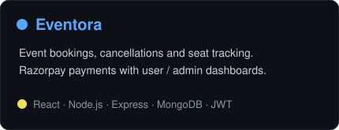
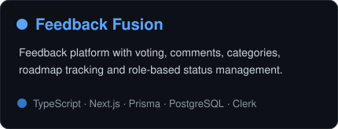

 

## 👨‍💻 About Me

I'm a **Full Stack Developer based in Noida, India**, with **2+ years of experience** building SaaS, e-commerce and workflow applications. Currently at **Clickseon**, I work on website performance, reusable interfaces and full-stack improvements.

I enjoy taking a product from its interface to the APIs, database, authentication and integrations that make it work.

## 🌟 Featured Projects

- **Eventora** · [Code](https://github.com/Vibudh08/Eventora) — JWT authentication, seat availability, booking/cancellation, Razorpay payments and booking emails.
- **Feedback Fusion** · [Code](https://github.com/Vibudh08/Feedback-Fusion) · [Live Demo](https://feedback-fusion-app.vercel.app/) — Feedback and voting with public roadmap tracking and admin-controlled statuses.
- **Taskflow** · [Code](https://github.com/Vibudh08/Taskflow) · [Live Demo](https://taskflow-task-management-dashboard.vercel.app/) — Searchable task workflows with optimistic updates and rollback on failed requests.
- **Nexora Digital** · [Code](https://github.com/Vibudh08/Nexora) · [Live Demo](https://nexora-digital-app.vercel.app/) — Lead management, AI chatbot, email automation and Razorpay test payments.

[Explore all repositories →](https://github.com/Vibudh08?tab=repositories)

## 💼 Experience & Engineering Highlights

### Clickseon · Full Stack Developer

**Jun 2026 - Present · Hybrid**

- Improved client websites to **90+ PageSpeed scores** by optimizing Core Web Vitals, LCP elements, image/media loading, render-blocking resources and third-party scripts.
- Refactored reusable components and fixed responsiveness, navigation and functional issues to improve stability and maintainability.

### Suntek.ai · Full Stack Developer

**Oct 2025 - May 2026 · Remote**

- Built a **Kanban SaaS platform** with Next.js and PostgreSQL, including board/list views, task workflows, advanced filtering and role-based access control.
- Built a **Shopify discount management app** with Node.js, automating discount syncing and product/variant metafield updates with ranking and eligibility logic, Docker workflows and cron jobs.

### BTJ Alpha Technology · Full Stack Developer

**Jul 2024 - Oct 2025 · Noida**

- Developed and deployed responsive web applications, including **Admirer, Non Brokerage and the company website**.
- Worked with React, Node.js, Express and MongoDB, using reusable components and Git/GitHub collaboration workflows.

## 🧰 Tech Stack

**Frontend**

Also: Zustand · Shadcn UI · Shopify Liquid

**Backend & Databases**

Also: REST APIs · Mongoose · Authentication & RBAC

**Tools & Platforms**

## 📊 GitHub Activity

<picture>
  <source media="(prefers-color-scheme: dark)" srcset="./assets/overview.dark.svg" />
  
</picture>

Languages & contribution history

 

<picture>
  <source media="(prefers-color-scheme: dark)" srcset="./assets/languages.dark.svg" />
  
</picture>

<picture>
  <source media="(prefers-color-scheme: dark)" srcset="./assets/contributions.dark.svg" />
  
</picture>

<picture>
  <source media="(prefers-color-scheme: dark)" srcset="./assets/momentum.dark.svg" />
  
</picture>

---

### 🤝 Let's Build Something Useful

Interested in full-stack opportunities, SaaS products, e-commerce and performance-focused web development.

**[Email](mailto:vibudhrathore8@gmail.com) · [LinkedIn](https://www.linkedin.com/in/vibudh08/) · [Portfolio](https://vibudh-portfolio.vercel.app) · [Resume](https://vibudh-portfolio.vercel.app/resume.pdf)**

