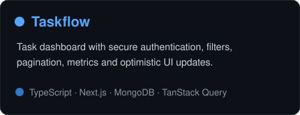
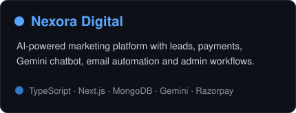

<div align="center">


<br/>

<a href="https://vibudh-portfolio.vercel.app"></a>
<a href="https://www.linkedin.com/in/vibudh08/"></a>
<a href="mailto:vibudhrathore8@gmail.com"></a>
<a href="https://github.com/Vibudh08"></a>

</div>

---

## 👨‍💻 About Me

<table>
<tr>
<td width="72%" valign="top">

I'm a **Full Stack Developer with 2+ years of experience** building scalable SaaS, e-commerce, workflow-management and performance-focused web applications.

- 🚀 Building production-ready apps with **Next.js, React.js, Node.js & TypeScript**
- ⚙️ Working across **frontend, backend, databases, REST APIs, authentication & RBAC**
- 🗄️ Experienced with **MongoDB, PostgreSQL, Prisma & Mongoose**
- 🛍️ Building and maintaining **Shopify / e-commerce** experiences
- ⚡ Improved client websites to **90+ PageSpeed scores** through Core Web Vitals optimization
- 🐳 Comfortable with **Docker, Git, GitHub, Vercel, Render & Postman**
- 💼 Currently working as a **Full Stack Developer at Clickseon**

</td>
<td width="28%" align="center" valign="middle">

</td>
</tr>
</table>

---

## 🧰 Tech Stack

<div align="center">

### Frontend


### Backend & Database


### Tools & Platforms


</div>

---

## 🌟 Featured Projects

<div align="center">

<a href="https://github.com/Vibudh08/Eventora"></a>
<a href="https://github.com/Vibudh08/Feedback-Fusion"></a>

<a href="https://github.com/Vibudh08/Taskflow"></a>
<a href="https://github.com/Vibudh08/Nexora"></a>

<br/><br/>

<a href="https://github.com/Vibudh08?tab=repositories"></a>

</div>

---

## ⚡ Performance & Engineering Focus

```text
Full-stack product development    ████████████████████
Next.js / React architecture      ███████████████████░
Node.js / REST APIs               ██████████████████░░
Core Web Vitals & PageSpeed       ██████████████████░░
MongoDB / PostgreSQL              █████████████████░░░
Shopify / E-commerce              ████████████████░░░░
```

**Performance work includes:** Core Web Vitals, LCP optimization, image/media loading, render-blocking resources, JavaScript/CSS execution, responsive UI improvements and third-party script optimization.

---

## 📊 GitHub Analytics

<div align="center">

<picture>
  <source media="(prefers-color-scheme: dark)" srcset="./assets/overview.dark.svg" />
  
</picture>

<br/>

<picture>
  <source media="(prefers-color-scheme: dark)" srcset="./assets/languages.dark.svg" />
  
</picture>

<br/>

<picture>
  <source media="(prefers-color-scheme: dark)" srcset="./assets/contributions.dark.svg" />
  
</picture>

<br/>

<picture>
  <source media="(prefers-color-scheme: dark)" srcset="./assets/momentum.dark.svg" />
  
</picture>

</div>

> These analytics cards are generated inside this repository by GitHub Actions and committed as SVG files, so the profile does not depend on the broken public readme-stats endpoint.

---

## 💼 Experience Snapshot

| Role | Organization | Focus |
|---|---|---|
| **Full Stack Developer** | **Clickseon** | Performance optimization, Core Web Vitals, client websites, reusable UI and full-stack improvements |
| **Full Stack Developer** | **Suntek.ai** | Next.js, Node.js, Shopify Liquid, SaaS workflows, PostgreSQL and automation |
| **Full Stack Developer** | **BTJ Alpha Technology** | React.js, Node.js, Express, MongoDB and responsive web applications |

---

## 📌 What You'll Find Here

- Full-stack web applications and SaaS products
- Authentication and authorization systems
- REST API and third-party integrations
- Payment and email automation workflows
- E-commerce and Shopify development
- Performance and Core Web Vitals optimization
- AI-powered product features

---

## 🤝 Let's Connect

<div align="center">

I'm interested in **full-stack development, SaaS, e-commerce, modern web products, performance optimization and challenging engineering problems**.

### Have a project, opportunity, or idea? Let's build something useful.

<a href="mailto:vibudhrathore8@gmail.com"></a>

<br/><br/>

<a href="https://komarev.com/ghpvc/?username=Vibudh08"></a>

<br/><br/>

**[Portfolio](https://vibudh-portfolio.vercel.app) · [LinkedIn](https://www.linkedin.com/in/vibudh08/) · [GitHub](https://github.com/Vibudh08)**

</div>
